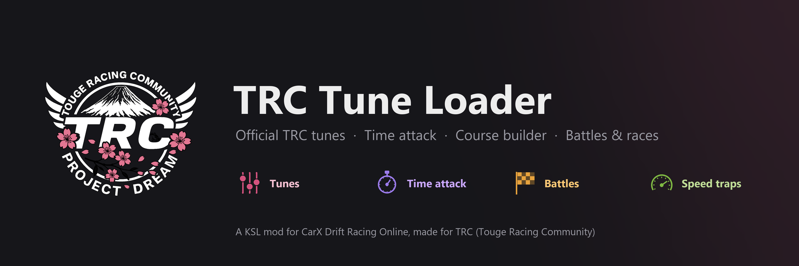
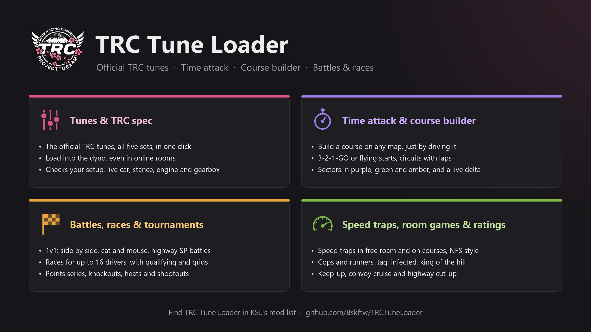

# TRC Tune Loader

**Official TRC tunes · Time attack · Course builder · Battles & races**

A KSL mod for CarX Drift Racing Online, made for TRC (Touge Racing Community). Build a course on any map, run it against the clock with a real 3-2-1-GO, then take it to the room: 1v1 battles, races for up to 16 drivers, tournaments and room games. And it keeps it fair: everyone races on the official TRC tunes, checked by the mod. Made with Project Dream in mind: maps can come with their own courses, sectors, grids and speed traps.

## What you can do

| | |
| --- | --- |
| **Tunes & TRC spec** | Put the official TRC tunes on your car in one click, and check your car, and every car in the room, for anything that isn't TRC spec. Every tune has a code the TRC Discord bot uses to verify leaderboard runs. |
| **Time attack & course builder** | Make your own courses on any map by driving them, or race the official ones. 3-2-1-GO or flying starts, circuits with laps, sectors in purple, green and amber, a live delta, and your best line drawn on the road. |
| **Battles, races & tournaments** | Challenge anyone in the room: side by side, cat and mouse, or a Tokyo Xtreme Racer style highway battle. Races for up to 16 drivers with qualifying and grids, then points series, knockouts and heats. |
| **Speed traps, room games & ratings** | Speed traps in free roam and on courses, room games (cops and runners, tag, infected, king of the hill, highway cut-up and more), and an Elo rating, Safety Rating and license that move as you drive. |

**Version 0.14.2** (Oct 27 2026). What changed in each version: [CHANGELOG.md](CHANGELOG.md).

**Still in testing.** The mod is new and still being tested, so bugs will happen, especially in the newest features (see "Tested in game" below). If something goes wrong, press **Report a bug** (Home or Options) and send bskftw the zip it puts on your Desktop.

## Installing

You need [KSL](https://github.com/trbflxr/ksl) (the CarX mod loader) installed. Then:

- **The easy way:** find **TRC Tune Loader** in KSL's mod list (ModDB) in game and install it from there.
- **Or by hand:** download `TRCTuneLoader.zip` from the [latest release](https://github.com/Bskftw/TRCTuneLoader/releases/latest) and unzip it into `CarX Drift Racing Online\kino\mods\`, so you end up with `kino\mods\TRCTuneLoader.ksm`. Then start CarX (KSL only looks for mods when the game starts).

Either way, the mod keeps its files (times, courses, backups, logs) in one folder: `kino\mods\TRCTuneLoader`. If you ever have two copies of `TRCTuneLoader.ksm`, the Home tab tells you which one to delete.

Either way, KSL keeps the mod up to date by itself: new versions install when you start the game.

## Opening it

- Press **Ctrl + T** (you can change this in the Options tab), or
- open the KSL menu and click **TRCTuneLoader**, then **Open the TRC Tune Loader window**.

The window has nine tabs: **Home**, **My car**, **Tune sets**, **Players**, **Mod check**, **Backups**, **Time attack**, **Options** and **About**. While your mouse is over it, clicks don't go through to the game.

**First time?** The first time you reach the garage after installing, the window opens with a short tour: a quick word about TRC, the tunes and Project Dream, then each tab. You can skip it, and take it again any time from Options. After an update, the window opens once on Home with **What's new** instead.

## Features

### Home

The window opens on Home:

- **Go to:** a button for each thing you'd want to do: practice a course, challenge someone, races and room games, my times and ratings, make a course, put a TRC tune on.
- **Waiting for you:** challenges to answer and races you can join.
- **In this room:** the room board. Every TRC Tune Loader player in the room (0.14 or newer) and what they're doing: in the garage, free roam, a time attack, battling, racing, in a race lobby, a room game or making a course, with their car and rating. Tick **I'm up for a battle** so others know you're free. **Challenge** takes you to the battle form with them picked; **Join** joins their race.
- **Courses shared with the room:** courses other players sent, with **Save** to keep them as your own (speed traps and grid included).
- **Report a bug:** write what happened (optional) and press **Make a bug report**. A zip lands on your Desktop with the mod's logs, a summary of what you were doing, your options and your mods. It has the names of players you raced, and no one's tune values. Send it to bskftw.

### My car

- **Status bar**: a coloured line that always says whether your car is TRC spec right now. Green means spec, amber means not checked yet, red means not spec.
- **Tune set picker**: choose which official set to use for your car. TRC Revival is the default.
- **Apply**: puts the official tune on your car from the main garage screen. Your own tune is backed up first, and the car visibly settles on the new setup.
- **Load into the dyno**: when CarX's tuning screen is open, Apply becomes this button. It works in the garage **and inside online rooms**. It moves CarX's sliders for you; leave the tuning screen and choose **Yes** when CarX asks to save. In a room, CarX shares the new setup with everyone.
- **Check my tune**: checks everything below and lists every difference it finds.
- **Real numbers**: every setting of the tune the way CarX's tuning screen shows it (for example spring stiffness in N/mm), plus the settings the tune doesn't list, which must stay at the car's default.
- **Your code**: the tune code of your current setup, like `TRC-95F4-06D9`. It equals the official code only when your car really matches.
- **Engine & drivetrain line**: for example "Stock engine · RWD · engine, gearbox and drivetrain match CarX's own data".
- **Workshop line**: names any Steam Workshop body on your car and whether it moves the wheels.

### What "TRC spec" means

Check makes sure all of these are true:

| Check | What it looks at |
| --- | --- |
| Saved setup | Every setting matches an official tune exactly. Settings the tune doesn't list must be at the car's default. |
| Live car | Every physics value of the car you're driving (suspension, tyres, engine, gearbox, diff, brakes, weight, downforce, and each wheel's suspension in the physics engine) still matches what CarX produced from the official tune. This catches edits made with tools like Unity Explorer. The mod records what to compare with by itself, a few seconds after your car reaches the garage or the track. |
| Stance | No body kit (including widebody kits) changes the track width, axle position or ride height compared with the stock body, and no single wheel sits at another height. Any change of 0.5 mm or more counts. |
| Workshop bodies | A Steam Workshop (or mod.io) body is fine if it only changes the looks. One that moves the wheels is not spec. |
| Engine | No engine swap: neither CarX's own engine swap nor a KINO engine swap. |
| Gearbox & drivetrain | Gear ratios, number of gears, final drive and drivetrain (RWD/AWD/4WD) match CarX's own data plus the official tune. This catches KINO gearbox swaps and other mods. |
| Suspension | Spring travel, spring stiffness, and fast and slow bump and rebound, front and rear, match CarX's own data plus the official tune. This catches KINO's air suspension and hydraulics, on your car and on other players' cars when you run KINO. |

Some settings never count: the wastegate and gearbox sounds (pick your own), your gearbox mode and clutch settings, and the diff your drivetrain doesn't use (the front diff on a RWD car).

### Tune sets

Five official sets are built into the mod. Players can't see or change the files.

| Set | Cars |
| --- | --- |
| **TRC Revival** (main, newest) | 58 |
| TRC V3.0 | 46 |
| TRC V2.6 | 73 |
| TRC V2.0 | 58 |
| TRC V1.0 | 69 |

The tab lists every car in a set. Click one to see its numbers. Some Revival tunes are identical to V2.0, so the mod says "same tune as TRC V2.0" where that's the case.

### Players

Works in any online room. For every player, including you:

- **Setup**: their setup, as CarX shares it with the room, checked against every official set. It names the set they match, or lists **what** is changed, without the values: everyone's own tune stays theirs. Your own car always shows its numbers, and so does anyone who turned on **Share my tune values** in their Options (off by default).
- **Engine**: CarX engine swaps are named and flagged.
- **Body kit stance and Workshop bodies**: the same checks as for your own car. If they use a Workshop body your PC doesn't have, it shows in amber as "stance unknown". Subscribe to the item and the mod can check it.
- **Engine, drivetrain & suspension**: compared with CarX's own data. Another player's KINO swap or air suspension only shows here if you run KINO too, because KINO is what puts it on their car on your PC.
- **TRC Tune Loader report**: players who also run the mod send their own check, KSL status and full mod list. These reports are self-reported, so treat them as hints for referees, not proof.

**Only problems** hides everyone who's fine and lists just the players worth a look: not TRC spec, not checkable, or their own report flags something (like Unity Explorer). The mod remembers which you picked.

Players see each other's reports only when they run the same report version (0.7 and newer talk to each other).

### Mod check

- Every mod KSL has loaded, with version and author.
- Whether KSL says all mods are verified, and whether KSL protected mode is on.
- Flags mods whose names look like game-editing tools (Unity Explorer, Runtime Unity Editor, anything called "cheat" or "trainer").

### Backups

Before Apply or Load into the dyno, the mod backs up your own tune (unless it's already official or already backed up). The Backups tab lists the backups for your current car and setup. **Restore** puts one back, from the main garage screen or into the dyno.

Backups are saved in `kino\mods\TRCTuneLoader\Backups`.

### Time attack

The Time attack tab shows the map you're driving on and has four parts: Courses here, Battle, My times and Course builder.

**Courses here** lists every course on this map:

| Kind of course | Where it comes from | Counts as TRC spec time |
| --- | --- | --- |
| Official TRC course | Built into the mod | Yes |
| Official (map objects) | Start, finish and path placed in the map by its maker, on maps TRC trusts | Yes |
| Map objects (not official) | The same, on other maps | Practice only |
| Your course | Made with the Course builder on your PC | Practice only |

Each course shows its kind (touge, highway or circuit), its length, its course code (like `CRS-1A2B-3C4D`, the same for everyone on the same course), its sectors and your best time, with the car and tune set. A downhill course from the map also comes as an uphill course, the same road the other way, and a circuit as a reverse circuit. **Show path** shows a course's road as light-blue dots on the road near you.

A map course that doesn't know its road yet shows **Record path**: drive through its start line and down the middle of the road to its finish line, and the mod remembers the road (on your PC, for practice). Official courses come with it already.

**Running a time attack:**

Above the list, pick the **start** and, for circuits, the **laps**:

| Start | How the clock starts |
| --- | --- |
| Standing | Stop behind the start line: 3-2-1-GO, and the clock starts at GO. |
| Flying | Drive through the start line at any speed: the clock starts as you cross it. |

Laps (circuits only) can be 1, 3, 5, 10 or **Unlimited**. Unlimited is practice: a lap with a shortcut or off the road just doesn't count, and you keep driving. Standing and flying times are kept apart.

1. Press **Time attack** next to a course. The window closes. The start line (green) and finish line (pink) show on the road, with a post at each end, when you're within 100 m of them. On maps with their own start and finish signs, the signs appear instead.
2. Drive to the start and stop behind the start line, between its ends, facing the way the course goes. Or open the window and press **Teleport to start**: CarX's own placement puts you just behind the line (for a flying lap of a circuit, a bit before it, for a run-up). **Ctrl + R** does the same any time during a time attack, without opening the window (change the key in Options).
3. Standing start: hold still, and a **3-2-1-GO** countdown starts. Moving before GO is a **jump start**, and you stop and try again. Flying start: just drive through the line.
4. A small timer shows your time (on a circuit, the lap time, with the lap, the total and your best lap under it) and a thin line for how far along you are.
5. **Sectors:** every course is split into sectors (3, or more on long courses; maps can mark their own). They stay on the timer, coloured as you finish each one: **purple** great pace (the best that sector has ever been driven), **green** on pace (your best in this car), **amber** below pace. My times shows the sectors of your times too. Options can hide them.
6. **Live delta:** once you have a best time in this car on this tune set, the timer shows how far ahead (green, minus) or behind (red, plus) you are right now.
7. Cross the finish line (on a circuit, after the last lap) to stop the clock. Your time, how it compares with your best, your sectors and whether it counts show for a few seconds. A circuit also shows the laps: the best, the average and how even they were. Then the run is ready for another go.

A run is stopped if you take a shortcut, leave the course, reset the car, change car or the game speed changes (in unlimited-lap practice, only that lap doesn't count). On maps that mark their roads (like Project Dream), the whole car leaving the road for half a second stops it too. Part of the car still over the road, or flying over it off a jump, counts as on the road. **Stop time attack** ends it.

**Battle** has two parts: **1v1 battles** and **Races & tournaments**. Both need TRC Tune Loader 0.13.0 or newer on every player.

**1v1 battles** challenge another player in the same online room:

1. Pick the opponent, a course on this map, the format, the laps (on a circuit) and the mode, and press **Challenge**. They see the challenge on screen and press the shortcut to answer it. A course of your own, or your recorded path, is sent to them with the challenge. You see when it gets to them, and why if they can't accept it. If you both challenge each other at once to the same course, format and mode, it becomes one battle by itself. The room board on Home shows who's up for a battle.
2. Both drive to the start, or press **Teleport to my spot**. In a race you line up side by side (the challenger on the left); in cat and mouse the leader is just behind the line (within 5 m) and the chaser at least 5 m back.
3. Stop in your spot. When both are ready, **3-2-1-GO** shows on both screens at the same moment (the mods measure the connection between you). Moving before GO calls the countdown off for both.
4. Each mod times its own car from GO to the finish line, with the same rules as time attack, except that a **reset doesn't end your run**: mess up, reset and keep going, and you can still win if the other driver messes up too. A reset that puts you further along the course does stop it. When the other driver's run stops, you're told straight away: finish to win.

| Format | Who wins |
| --- | --- |
| Side-by-side race | The faster time. Closer than 0.1 s is a dead heat: run it again. |
| Cat and mouse | The chaser wins a run by passing and staying ahead to the finish. The leader wins by finishing far enough ahead: 1.5 s while you both have your first lead, 1 s for your second, then 0.5 s. Otherwise you swap places and go again; the first run with a winner wins. |
| Highway battle (SP) | Tokyo Xtreme Racer style, anywhere on the map, no course. Drive alongside each other at speed for a rolling 3-2-1, then whoever's behind loses SP, faster the bigger the gap. A hit costs SP too. Empty SP, or 600 m behind, loses. |

A driver who doesn't finish loses the run to one who does. When it's over, **Run it back** challenges them again with the same course and format. After a battle against someone else's course, **Save this course** keeps it in your courses, to practise on. **TRC spec** battles need both cars TRC spec on the same tune set, with no flagged mods, at every start and finish; **Open** battles take any setup and don't count. After ten runs without a winner it's a draw. If the other driver leaves or stops answering for 10 seconds, the battle ends. Every battle is saved in `kino\mods\TRCTuneLoader\TimeAttack\battles.csv`.

**Races & tournaments** are for up to 16 drivers:

1. **Host a race:** pick the course, the laps (circuits), the grid order (order joined, random, best time or qualifying), pole on the left or right, two-wide or line-up, the jump-start rule (+5 s or disqualified), TRC spec or Open, how many drivers, and optionally a tournament. Press **Open the race**.
2. Everyone in the room with the mod sees a pop-up and the race in **Open races**, and presses **Join**.
3. The host can run **qualifying** first: everyone drives time attacks for a few minutes, and the best times set the grid.
4. The host presses **Start race**. Drive to your grid spot or press **Teleport to my spot**, and stop. When everyone's lined up (or the host presses **Go now**), 3-2-1-GO lands on every screen at once.
5. The timer shows your place (P3/12), the lap, and the gaps to the cars just ahead and behind. The race ends when everyone has finished, or when the host ends it (in 60 s or now). Resets don't end your race; jump starts get the penalty the host picked.
6. Everyone gets the same results, with times, gaps and best laps. The host's **Run it back** starts the same race again with the same drivers.

| Tournament | How it works |
| --- | --- |
| Points series | Several races, scoring 25-20-16-13-11-10-9-8-7-6-5-4-3-2-1-1, +1 for the fastest lap on circuits. Rounds can use a reverse grid. |
| Knockout | 1v1 battles in a seeded bracket (byes for top seeds), best of 1 or 3, with its own final format and a battle for 3rd. The host calls each battle, and the two drivers' mods start it by themselves. |
| Heats and final | Heats of 4 to 8 drivers; the top of each goes through to one final race. |
| Shootout | A timed session of time attacks: the best time wins. |

Races can also be scored on **speed traps** (when the course has some): the highest total of trap speeds wins.

**Race control:** the mod notices when your car suddenly stops: next to another car it's **possible contact**, anywhere else a **hit**. The host sees each driver's incidents and can give +5 s, +10 s or a disqualification in the results (or clear it). A **yellow flag** shows when a car ahead is stopped or off the road, a **blue flag** when a car a lap ahead is right behind you.

**Room games:** instead of a race, the host can pick a game under **What to play**. Games are played anywhere on the map, no course, in rounds of 3 to 15 minutes:

| Game | How it works |
| --- | --- |
| Cops and runners | A runner stopped (under 25 km/h) next to a cop for 3 s is busted and joins the cops. Runners score every second they're free, cops per bust. |
| Tag | One driver is it: touch someone to pass it on. You score every second you're not it. |
| Infected | Touching spreads it. You score every second you're clean, and the last survivors win. |
| King of the hill | The hill is where the host is when the game starts. Score every second you're on it alone. |
| Keep-up | Follow the host: too far behind for 10 s and you're out. |
| Convoy cruise | A cruise behind the host, with everyone's gap to the car ahead. No winner. |
| Highway cut-up | Points for close, fast passes on other players (over 80 km/h, at least 10 km/h faster, within 5 m), with a combo for passes in a row, up to x10. A hit loses the combo. |

Circuits can also run as an **elimination race**: the last car each lap is out. **Lay out grid** in Courses here sets where cars line up: pick Two-wide or Line-up, drive back from the start line, turn round, and drive down the middle of the road up to the line and through it.

**Speed traps:** drive through a speed trap and your speed flashes on screen: **purple** for a new best on that trap, **green** close to it, **amber** slower. In free roam they work whenever you're not in a time attack, battle or race. **Courses here** lists the map's traps with your best speed, turns free-roam traps on or off, and **Add speed trap here** places one where your car is, facing the way you're going. A course's **Edit** can add traps along its road too: they flash during the run, and your trap speeds are saved with the time. Maps can come with their own.

**Best line:** during a time attack, where you drove on your best run (or best lap) in this car shows as dots on the road, coloured by speed (blue slow to red fast) or in one colour. Options can turn it off.

**Moving the timer:** while a time attack runs, open the window and drag the timer anywhere on the screen. It stays there; Options can put it back at the top.

A time counts as **TRC spec** when your car is TRC spec at the start and at the finish (the same check as My car) and no mod is flagged. Other times are kept too, marked as not counted.

**My times** has four views:

| View | What it shows |
| --- | --- |
| Best times | Your maps and courses. Open a course to see a row for each car and TRC tune set: best standing and flying runs, the best lap and runs per number of laps on a circuit, and the **theoretical best** (your best sectors added up), when it's faster than your best. |
| Best laps | The same, for circuits only: best lap and theoretical lap per car and set. |
| Recent | Your latest 40 times, newest first, with sectors and speed trap speeds. |
| Ratings | Your license, Safety Rating and Elo for touge, highway and circuit, and the latest changes. |

**TRC spec only** hides the times that don't count. A car on TRC Revival and the same car on V3.0 have separate times. Every finished run, and every lap of a circuit that counts, is saved in `kino\mods\TRCTuneLoader\TimeAttack\runs.csv`, with the tune set it used.

**Ratings:** an **Elo** rating for each kind of course (touge, highway, circuit), moved only by TRC spec battles and races, and a **Safety Rating** that goes up with clean kilometres and down with incidents (resets, hits, possible contact, leaving the road, jump starts). Keep it at 3.00 or more over enough events to move up a **license** (Rookie, D, C, B, A); below 1.00 you go down one. Other TRC Tune Loader players see your license and Elo. For now they're kept on your PC; they'll be checked and shared once the TRC server is up.

**Course builder** makes your own practice courses on any map, one step at a time. First pick **Point to point** or **Circuit**:

1. **Start**: pick how wide the lines are, stop with the middle of your car on the start line, and press **Set start here**.
2. **Drive**: close the window and drive the course down the middle of the road. The route is recorded as you go and shows as light-blue dots on the road; resetting the car loses it. A circuit: drive once round (at least 200 m) and back through the start line the way you set off, and the loop closes by itself.
3. **Finish** (point to point only): stop with the middle of your car on the finish line and press **Set finish here**. If that's back where you started, the builder tells you to make it a circuit.
4. **Save**: name it (the car is stopped, so typing doesn't move it), pick Touge or Highway, and press **Save course**.

Your courses are saved in `kino\mods\TRCTuneLoader\Courses`. In Courses here, **Edit** on one of them lets you **share it with the room** (everyone with 0.14 or newer can save it), rename it, change the line width, flip its direction (a circuit: drive it the other way), record the path again, or delete it. Anything but the name gives the course a new code, so your old times stay under the old one.

### Options

- **Shortcut**: press **Change shortcut**, then the keys you want (for example Ctrl + T or F8). Ctrl, Shift and Alt can be combined with any key. **Reset** goes back to Ctrl + T. The shortcut doesn't fire while you're typing in CarX's chat.
- **Restart key** (Ctrl + R): during a time attack, sends your car back to the start line, ready to go again. **Change restart key** picks another.
- **Best line**: speed colours, one colour, or off.
- **Share my tune values** (off by default): lets other TRC Tune Loader users see your tune's real values on their Players page. Off, they only see what you changed.
- **Wheel and controller buttons**: **Pick a button**, then press it on your wheel or controller. The **TRC action** button does what fits right now: accepts a challenge, joins a race that just opened, runs the last battle or race back, or restarts your time attack. **Open the window** opens and closes this window. Pick buttons CarX doesn't use: CarX still sees every press.
- **Report a bug**: the same as on Home.
- **Window size**: 80% to 150%. Also sizes the badge and the pop-up.
- **TRC spec badge** (off by default): a small tag in a corner while you drive. Green "TRC SPEC" with your set, amber for the few seconds before the car you're driving has been checked, red "NOT TRC SPEC". Pick the corner it sits in.
- **Time attack timer**: drag it while the window is open during a run. **Put the timer back at the top** resets it.
- **Check my car on the track** (off by default): a few seconds after you reach the track, and whenever your car changes while you drive, it's checked. A short message pops up only if something isn't TRC spec. Click it or press the shortcut for details.
- **Backups**: keep all of them, or only the last 5, 10 or 20 for each car and setup. Older ones are deleted when a new backup is saved. **Clean up now** shows how many would go and asks again before deleting.
- **Take the tour**: the first-run tour again.

Options are saved with KSL, so they stay when you restart the game or update the mod.

### About

The story behind the mod: TRC and its founder WingsX, the TRC Ultimate Grip Tunes and why they're balanced the way they are, Project Dream and how its roads came together, and what's coming next. There's also a button to this mod's page.

## Tune codes (for the Discord bot)

The code is made from the car's ID, its setup (for example the AE86's Ultimate setup) and every tune value rounded to 3 decimals, sorted by name. The same tune always gives the same code; change any value and the code changes. Sound-only settings don't count. It looks like `TRC-XXXX-XXXX`.

- `tools/tune_code.py` makes the same code in Python for the bot. It reads `.trctune` files, KINO `.knd` files and zips of them.
- The Tune sets tab shows each official tune's code, and every tune's code is written to the mod's log when it starts.

## Log

The mod writes what it does to its own log, `kino\mods\TRCTuneLoader\TRCTuneLoader.log` (the last session's is kept as `TRCTuneLoader.previous.log`), and to KSL's log, `kino\output.log`. If something goes wrong, those files help find out why.

## Honest limits

- No check that runs on a player's own PC is cheat-proof. Someone who edits the game can also edit this mod. Replays, the mod list and the setup CarX shares with the room are the backstops.
- Reports from other TRC Tune Loader users are self-reported.
- A KINO swap or air suspension on another player's car only shows if you run KINO. A Workshop body you don't have can't be checked.
- KINO is closed code, so the mod sees what a KINO swap does to the car, not the swap's name.
- Taking a KINO swap off can leave values behind (seen with the clutch). Press Apply to put CarX's own values back.
- CarX's paint screen briefly changes some engine values, so a Check while it's open can show differences.
- Times, battles, races and ratings are saved on your own PC only, for now. They're kept ready for the TRC server.

## Feature status

| Feature | Since | Tested in game |
| --- | --- | --- |
| Apply, Check saved setup, backups and restore, real numbers | 0.2 | Yes |
| Built-in tunes, Players page, shared reports between TRC Tune Loader users | 0.3 | Yes, with a second player |
| Five tune sets with a set picker | 0.4 | Yes |
| TRC window | 0.5 | Yes |
| Live car check | 0.3 | Yes |
| Body kit stance (widebody) check | 0.5 | Yes |
| Load into the dyno, also in online rooms | 0.6 | Yes (found the V3.0 diff issue fixed in 0.6.1) |
| Unused diff skipped in the live check | 0.6.1 | Yes |
| Workshop bodies | 0.7 | Not yet: no Workshop car to test with |
| Engine & drivetrain check | 0.7 | Yes: KINO gearbox swap, KINO drivetrain change (FWD and AWD) and KINO engine swap were all caught |
| First-run tour, Options tab, changeable shortcut | 0.8 | Yes |
| TRC spec badge, track check pop-up, window size, backup clean-up, Players filter | 0.9 | Yes |
| Time attack tab: 3-2-1-GO, My times, Course builder, courses from map objects | 0.10 | Course builder and a time attack on Project Dream: yes. Teleport, movable timer, step-by-step builder, map objects: not yet |
| Suspension check (KINO air suspension and hydraulics), live check recorded by itself | 0.10 | KINO air and hydraulics caught by the live check: yes. Suspension check from CarX data: not yet |
| Battles: side-by-side race and cat and mouse, synced 3-2-1-GO | 0.10 | Yes: side-by-side races and cat and mouse on Project Dream |
| Battle challenges on courses with a path, challenging each other at once | 0.10.1 | Not yet |
| Circuits, laps, flying start, sectors, live delta, restart key, My times views, course editing, resets in battles | 0.11 | Not yet |
| Open races for 16, qualifying, grids, tournaments (points, knockout, heats, shootout), elimination races | 0.12 | Not yet |
| Speed traps, ratings and licenses, best line, race control, room games, highway battles | 0.13 | Not yet |
| Home, room board, share a course, wheel buttons, Run it back, Report a bug, new tour | 0.14 | Not yet |

